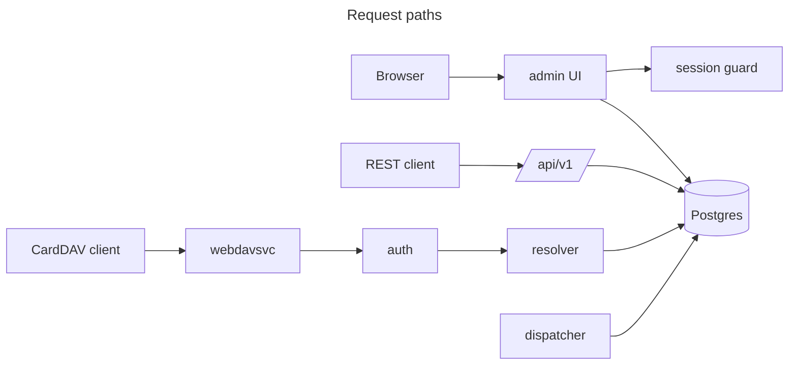

<h1 align="center">mnemo</h1>

<p align="center">A CardDAV address book server with one book per account, sliced per device.</p>

<p align="center">
  <a href="go.mod"></a>
  <a href="internal/store/migrations/0001_schema.sql"></a>
  <a href="internal/web/webdavsvc"></a>
  <a href="internal/web/pages"></a>
  <a href="README.md#license"></a>
</p>

<table>
  <tr>
    <td align="center"><br><sub>Overview</sub></td>
    <td align="center"><br><sub>Contacts</sub></td>
  </tr>
  <tr>
    <td align="center"><br><sub>Contact</sub></td>
    <td align="center"><br><sub>Lists</sub></td>
  </tr>
</table>

> [!NOTE]
> I run this for my own contacts. It works end to end with DAVx5 and vdirsyncer, and I have not tested it against iOS or Thunderbird yet.

## Why I built it

Every CardDAV server I tried gives one address book per account and nothing more. I wanted a single contact pool that I can tag into lists, where my phone sees family and work, my laptop sees everything, and an old tablet sees nothing but the medical numbers.

mnemo is that server. Contacts live in Postgres, lists are tags, and every device gets an address book built for it at request time. No device knows the others exist.

## Contents

- [Screens](#screens)
- [Running it](#running-it)
- [Connecting a client](#connecting-a-client)
- [The web UI](#the-web-ui)
- [Contact search](#contact-search)
- [Import and export](#import-and-export)
- [Sharing and invites](#sharing-and-invites)
- [REST API](#rest-api)
- [Configuration](#configuration)
- [How it works](#how-it-works)
- [Repository layout](#repository-layout)
- [Testing](#testing)
- [Status](#status)
- [License](#license)

## Screens


## Running it

The dev shell is devenv. It provides Go, `templ`, Tailwind, and a local Postgres.

```bash
devenv shell
go run ./cmd/server
```

On boot the server applies migrations and creates an `admin` account when the users table is empty. The credentials are `admin@example.com` and `password`. The server listens on `:8080`.

For screenshots or manual CardDAV testing, the seed command fills an empty database with four lists, about seventy contacts, and two device tokens:

```bash
go run ./cmd/seed
```

Without `SESSION_SECRET`, the server signs session cookies with a random key on startup, so a restart logs you out. Set the variable to keep sessions across restarts.

## Connecting a client

Point any CardDAV client at the server root and use the account password:

| Field    | Value                 |
| -------- | --------------------- |
| URL      | `http://host:8080/`   |
| Username | `admin` (or an email) |
| Password | the account password  |

`.well-known/carddav` answers with a redirect to `/carddav/`, so most clients find the collection on their own. Password auth sees every list.

A device token is the other way in. Mint one under Devices in the UI or with `POST /api/v1/principals`. The token is shown once, and it belongs to a tier that controls what the device can read:

| Tier        | Sees                                  |
| ----------- | ------------------------------------- |
| `primary`   | every list in `books.synced_tiers`    |
| `secondary` | the same, meant for a second device   |
| `archived`  | nothing until you enable lists for it |

A per-book override on the principal hides or restores a single list for one device.

DAVx5 and Thunderbird cannot send an `Authorization: Bearer` header, so a token is useless there unless the server accepts it as a Basic password. Start with `INSECURE_TOKEN_AUTH=true` to allow that. The token then crosses the network in clear text, so use it on a trusted network or behind TLS.

Each card's `CATEGORIES` property mirrors the lists it is tagged into. The server owns that property and overwrites whatever the client sends, so a client that groups by category shows your list names.

## The web UI

The dashboard is server rendered with templ and htmx. Alpine handles the menus, the selection bar, and the command palette.

- Overview counts contacts, lists, and devices, and shows recent activity.
- Contacts is a sortable table with bulk tagging, bulk delete, import, and export.
- Lists renders each list as a card with its contacts, the device tiers it syncs to, and a per-list export.
- Devices manages tokens and their hidden lists.
- Settings holds the profile, the default list, and the network panel.

Press `Ctrl+K` (or `Cmd+K`) anywhere to search contacts and jump to pages.

## Contact search

The search box and `GET /api/v1/contacts?q=` share one query language. Terms are ANDed by default. `or`, `not`, `no`, and a leading `-` change that.

| Syntax                              | Meaning                             |
| ----------------------------------- | ----------------------------------- |
| `josh`                              | any free-text field contains `josh` |
| `"josh smith"`                      | one phrase                          |
| `name:josh`                         | name contains `josh`                |
| `name="Josh Smith"`                 | exact name                          |
| `name:jo*`                          | name starts with `jo`               |
| `email:*`                           | has an email                        |
| `has:phone`, `has:email`, `has:org` | has that field                      |
| `in:"Family Reunion"` or `in:#42`   | in a list                           |
| `untagged:true`                     | not in any list                     |
| `no has:email`                      | no email                            |
| `updated>30d`                       | updated in the last 30 days         |
| `(org:acme or org:beta) -in:Work`   | grouping and negation               |

An unknown field does not blank the results. The server reports it as a warning next to the search box. The UI also renders the parsed query as a sentence, so `no has:email` reads as "With no email".

## Import and export

Import takes a `.vcf` file or a `.zip` of them. A card's `CATEGORIES` become lists, which the server creates when they do not exist. Cards without categories land in no list.

Export writes a single `.vcf` or a zip of one file per contact, and can keep or strip `CATEGORIES`. When you start from a list, the export can also limit itself to that list and drop category values that belong to other lists.

## Sharing and invites

The network panel in Settings takes an email address and returns a link. Open the link and the server stores it in your session, sends you to sign in, then resumes at the invite. Accepting adds both accounts to each other's network and records the reverse id on the invite.

Invitations carry an email, but the server does not check it at acceptance. Anyone holding the link can take the invite.

Contact sharing, synced shares, and groups are the next phase. The sidebar shows both entries as coming soon.

## REST API

Everything under `/api/v1` uses the same bearer-or-basic auth as CardDAV, except signup.

| Method and path                                 | Effect                               |
| ----------------------------------------------- | ------------------------------------ |
| `POST /users`                                   | Create an account                    |
| `GET /me`, `PATCH /me/settings`                 | Current user and default list        |
| `GET\|POST /principals`                         | List devices, mint a token           |
| `PATCH\|DELETE /principals/{id}`                | Rename, move tier, or revoke a token |
| `PUT\|DELETE /principals/{id}/overrides/{book}` | Hide or show one list on one device  |
| `GET\|POST /books`                              | List and create lists                |
| `POST /books/reorder`                           | Set the dashboard order              |
| `PATCH\|DELETE /books/{id}`                     | Edit or delete a list                |
| `GET /contacts?q=`                              | Search with the language above       |
| `GET\|POST /contacts`                           | Read or create a contact             |
| `PATCH\|DELETE /contacts/{id}`                  | Update or soft delete                |
| `POST /contacts/{id}/tags`                      | Attach or detach lists               |
| `POST /events/force-resync`                     | Ask every device to resync           |

CardDAV itself lives at `/carddav/` and supports `GET`, `PUT`, and `DELETE` of `text/vcard`, `addressbook-query`, `addressbook-multiget`, and `sync-collection` (RFC 6578), plus an address book `PROPFIND` with `getctag`.

## Configuration

| Variable              | Default     | Purpose                                                  |
| --------------------- | ----------- | -------------------------------------------------------- |
| `ADDR`                | `:8080`     | Listen address                                           |
| `DATABASE_URL`        | unset       | Full connection string; wins over the `PG*` variables    |
| `PGHOST`              | `localhost` | Postgres host                                            |
| `PGPORT`              | `5432`      | Postgres port                                            |
| `PGUSER`              | `$USER`     | Postgres user                                            |
| `PGDATABASE`          | `$USER`     | Postgres database                                        |
| `SESSION_NAME`        | `session`   | Cookie name                                              |
| `SESSION_SECRET`      | random      | HMAC key for session cookies; set it to survive restarts |
| `COOKIE_SECURE`       | `false`     | Send cookies over HTTPS only                             |
| `COOKIE_SAMESITE`     | `lax`       | Cookie SameSite policy                                   |
| `INSECURE_TOKEN_AUTH` | `false`     | Accept a device token as the Basic password              |

## How it works

One CardDAV request that mutates data is one transaction. Writes that touch the change stream or a principal's epoch take a per-user advisory lock, so change ordering stays consistent across concurrent requests. Repository reads carry the acting user, which keeps a query from crossing accounts.



The resolver turns an authenticated actor into a set of visible lists. A password actor sees every list. A token actor sees the lists its tier allows, minus the ones overridden for that principal, and the address book is assembled from that set on every request. That is why one account can present different address books to different devices without storing a copy per device.

The dispatcher polls the `user_events` outbox every 250ms and pushes a `force_resync` event to the devices it is addressed to. Contact deletes are soft. A purge loop removes tombstones after two days.

## Repository layout

```text
cmd/server/            entrypoint: config, migrate, bootstrap admin, start workers
cmd/seed/              fixtures for manual testing: lists, contacts, device tokens
internal/
  api/                 /api/v1 handlers
  auth/                bearer + basic resolution, actor in request context
  config/              environment variables into one struct
  contact/             structured contact model shared by the form and REST
  jobs/                outbox dispatcher and tombstone purge
  model/               plain structs and error sentinels
  resolve/             which lists a caller can see (tier + overrides)
  search/              query language: AST, lexer, parser, descriptions
  store/               migrations (embed.FS) and scoped repositories
  testdb/              one Postgres database per test package
  vcard/               vCard encode, decode, and search metadata
  web/admin/           dashboard handlers, session guard, CSRF
  web/layouts/         root, auth, dashboard, and modal shells
  web/pages/           templ pages and shared components
  web/seg/             request-scoped UI segments
  web/uictx/           request context for the UI
  web/webdavsvc/       CardDAV over go-webdav, plus the sync and ctag shim
  websession/          HMAC session cookie and CSRF
assets/                Tailwind input and the built stylesheet
```

## Testing

Each package that touches Postgres creates its own database and resets it before running, so Go's package parallelism stays on.

```bash
go test ./...
```

## Status

What works today:

- Schema and migrations, signup, and the first-admin bootstrap.
- Contact CRUD with etags, a per-user change stream, soft delete, and purge.
- Lists with device tiers, per-device overrides, and epoch bumps.
- Device tokens and the REST surface.
- CardDAV sync with `sync-collection`, `getctag`, and `CATEGORIES` derived from lists.
- Contact search with the query language.
- Import and export of `.vcf` and `.zip`.
- Profile photos and family-name-first sorting.
- Network invites with token links and a login resume flow.

Next is contact sharing, both the static copy and the synced link, then groups and shared lists. Neither exists yet, so the sidebar marks them as coming soon.

### Deviations from the design

`STRATEGY.MD` is my design contract and is not committed. Where the code differs, I list it here instead of leaving it implicit.

- DAV paths. Cards live at `/carddav/{username}/contacts/all/{filename}` and `.well-known/carddav` redirects to `/carddav/`, not `/dav/`. go-webdav derives resource types from path depth, which rules out the contract's `/dav/contacts/{username}/` split.
- `search_meta` keys are `fn, uid, n, emails, org, tels, tel_norm`. The contract freezes the same set without `n`, which was added for name search.
- Phone normalization keeps digits and a leading `+`, and rewrites a leading `00` to `+`. Region-code prefixing needs a settings column that does not exist.
- PUT statuses. A malformed vCard returns 400, not 415, and an update returns 201, not 204. Both come from the go-webdav handler.
- Module names are `internal/store` and `internal/web/webdavsvc`, and the dispatcher sits in `internal/jobs`.
- Epoch bumps advance `sync_epoch` by one per principal instead of jumping everyone to a global maximum. The invariant that matters, a strictly increasing epoch per principal, still holds, and the global counter was a contention point.
- The segment cache was removed. The only loader reads request context, so caching never applied.

## License

No `LICENSE` file. This is a personal project, not a library. Read it, borrow ideas, expect no support.
