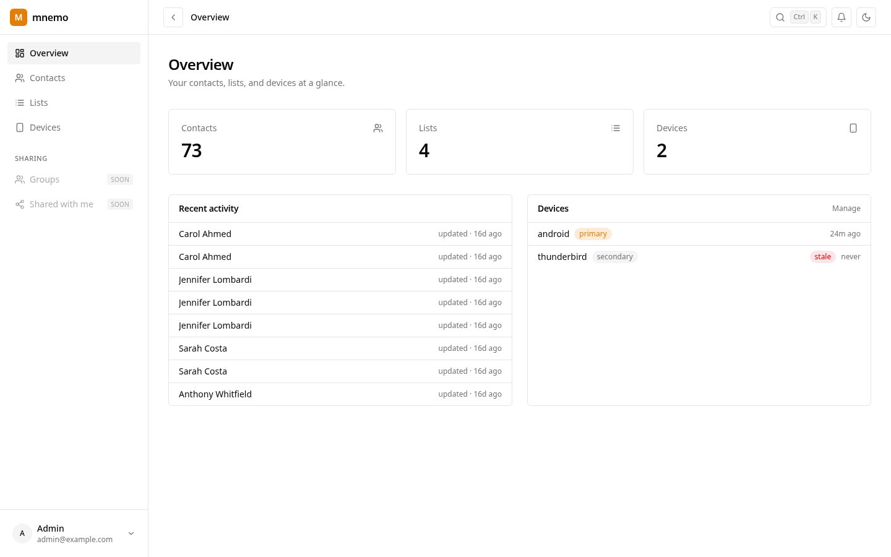
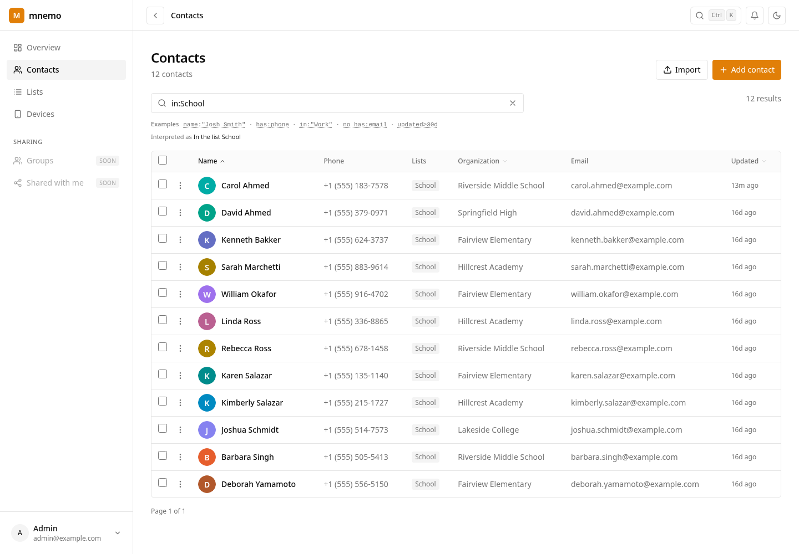
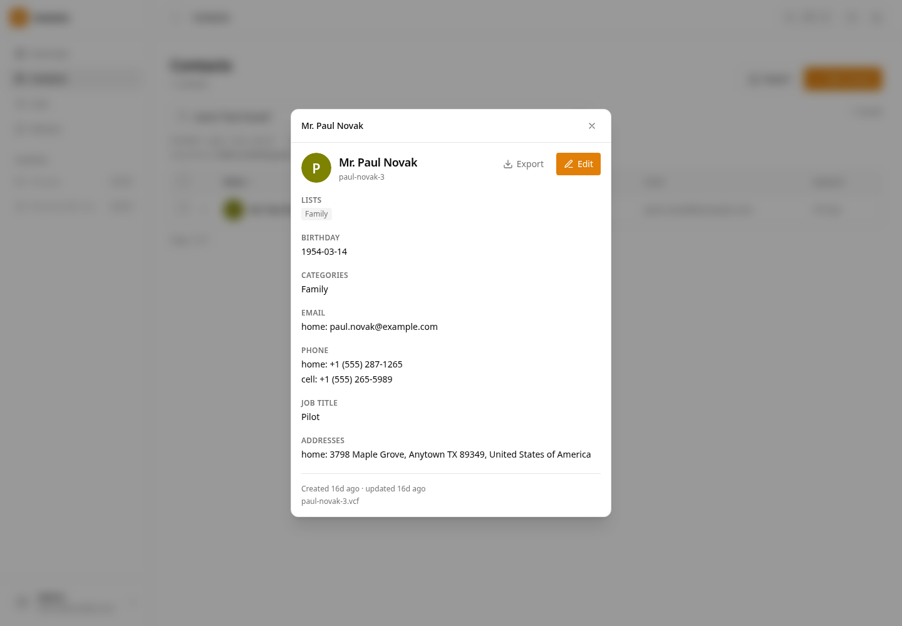
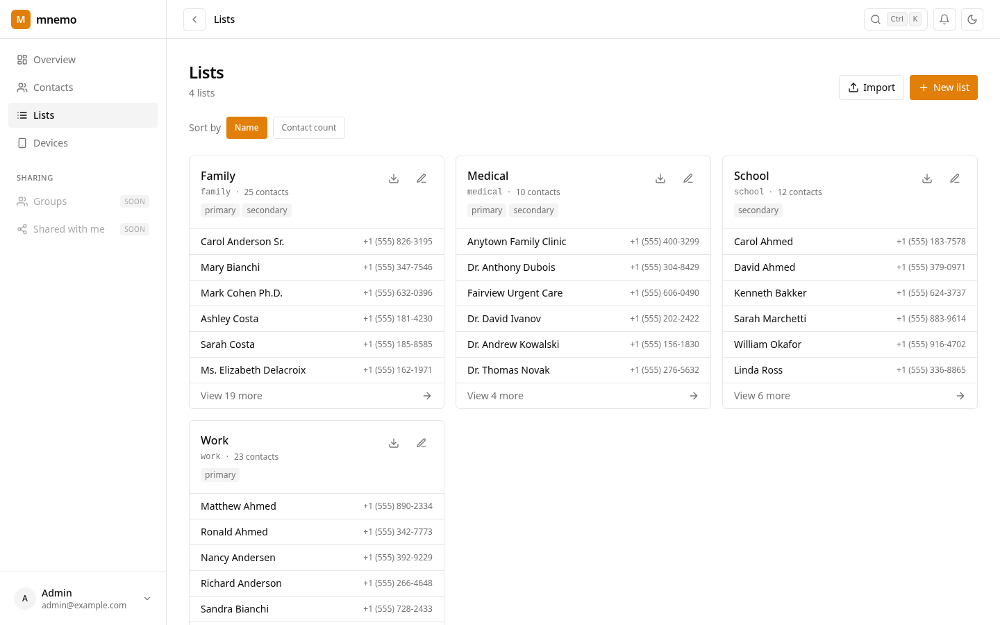
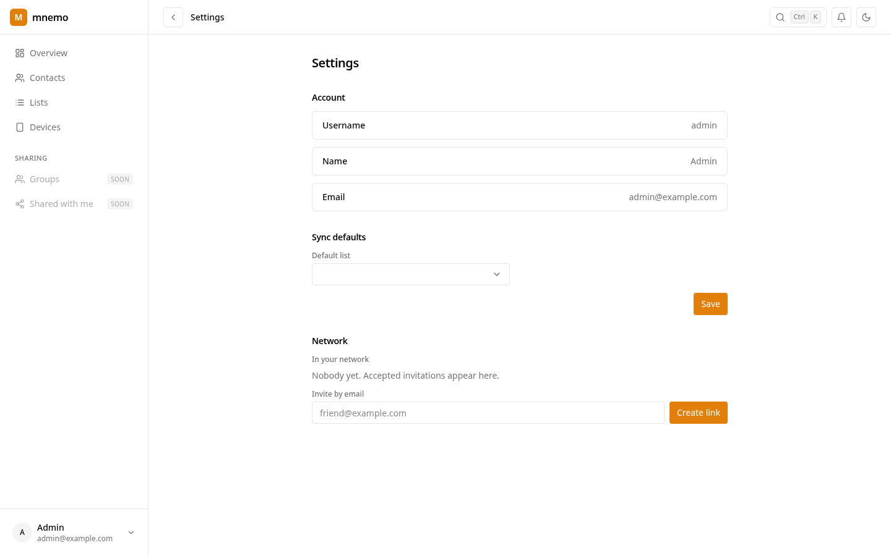
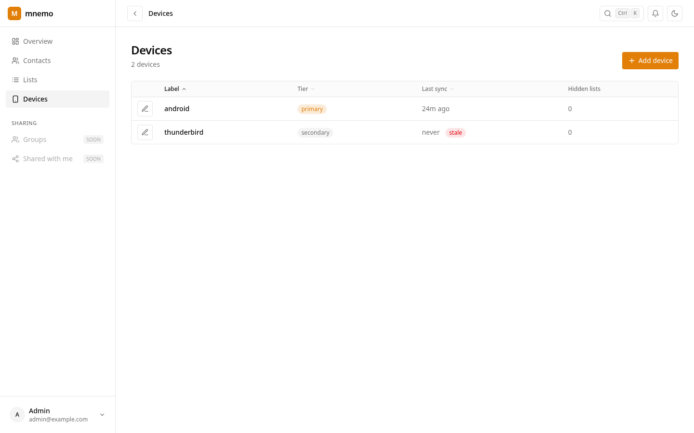
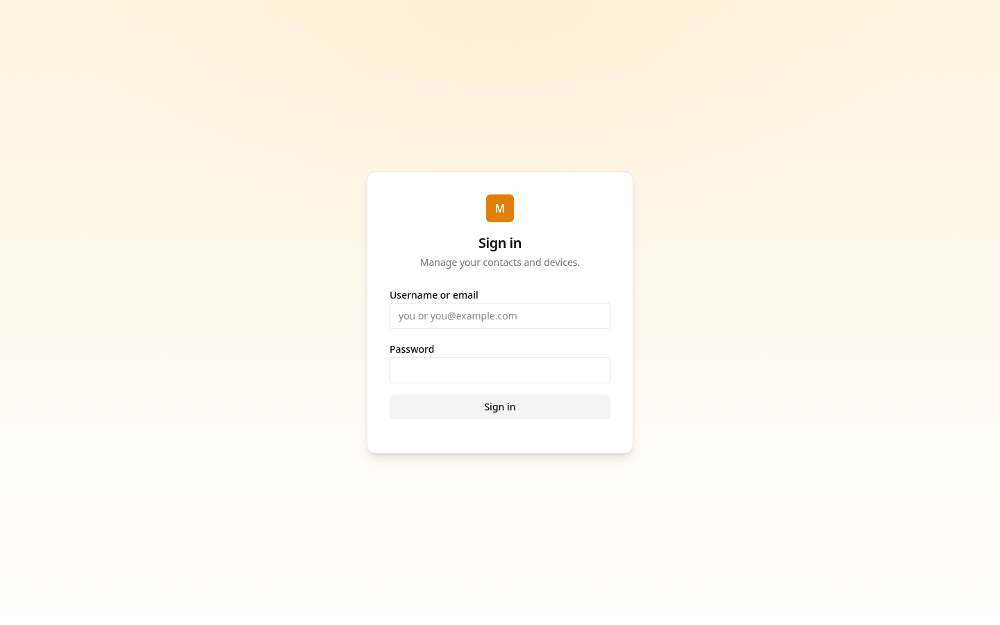

<h1 align="center">mnemo</h1>

<p align="center">A CardDAV address book server that keeps every contact while syncing only the ones you choose.</p>

<p align="center">
  <a href="go.mod"></a>
  <a href="internal/store/migrations/0001_schema.sql"></a>
  <a href="internal/web/webdavsvc"></a>
  <a href="internal/web/pages"></a>
  <a href="LICENSE"></a>
</p>

<p align="center">
  
</p>

## Why

My phone has hundreds of contacts and I call maybe a dozen of them. Every contacts server I tried makes you pick: live with the clutter, or delete people and lose the name behind the next unknown call.

mnemo is my answer. The full book lives on the server, and each device only syncs the lists you turn on for it. Nothing gets deleted, it just stops following you around.

## The idea

- **Lists are tags.** A contact can be in any number of lists, and the server mirrors that into each card's `CATEGORIES`, so regular CardDAV clients show your lists as groups.
- **Devices get tiers.** Each device has its own token and a tier that decides which lists it sees. You can also hide a single list on a single device.
- **One account, many address books.** The server builds the visible address book per request from the device's tier, so there's no copy stored per device.

Works with DAVx5, Thunderbird, and anything else that speaks CardDAV.

## Screens

<table>
  <tr>
    <td align="center"><br><sub>Contacts, filtered to one list</sub></td>
    <td align="center"><br><sub>One contact</sub></td>
  </tr>
  <tr>
    <td align="center"><br><sub>Lists</sub></td>
    <td align="center"><br><sub>Settings</sub></td>
  </tr>
  <tr>
    <td align="center"><br><sub>Devices</sub></td>
    <td align="center"><br><sub>Sign in</sub></td>
  </tr>
</table>

## Current Features

- CardDAV sync, including `sync-collection` (RFC 6578)
- Lists, device tiers, and per-device overrides
- Contact search with its own small query language, e.g. `(org:acme or org:beta) -in:Work updated>30d`
- `.vcf` / `.zip` import and export
- A server-rendered web UI with a `Ctrl+K` command palette
- Network invites between accounts

## Under the hood

Go, Postgres, templ, htmx, and a bit of Alpine. Every mutating CardDAV request is a single transaction, and per-user advisory locks keep the change stream ordered under concurrent writes. A small dispatcher polls an events outbox and tells devices to resync when something changes.

## Try it

```bash
devenv shell
go run ./cmd/server
go run ./cmd/seed
```

There are no default accounts. On first boot, open the server and register the first account at `/register`. It becomes the owner and registration closes. Point a CardDAV client at the server root and sign in with it.

To change a password later, run `server -set-password you`. It reads the new password from `NEW_PASSWORD`, or from stdin when that is unset.

## Configuration

| Variable             | Default                                               | Purpose                                                                |
| -------------------- | ----------------------------------------------------- | ---------------------------------------------------------------------- |
| `ADDR`               | `:8080`                                               | Listen address                                                         |
| `DATABASE_URL`       | built from `PGHOST`, `PGPORT`, `PGUSER`, `PGDATABASE` | Postgres connection string                                             |
| `SESSION_SECRET`     | random per start                                      | Signs the web session cookie. Set it, or sessions reset on restart     |
| `COOKIE_SECURE`      | `false`                                               | Set `true` when the server is reached over HTTPS                       |
| `TRUSTED_PROXIES`    | loopback                                              | CIDRs whose `X-Forwarded-For` is honoured. Add your reverse proxy here |
| `AUTH_FAILURE_LIMIT` | `20`                                                  | Credential failures per client address per minute, on each plane       |
| `DAV_TOKEN_PASSWORD` | `false`                                               | Let a DAV client send its device token as the Basic password           |

The DAV plane, the REST API, and the admin UI each keep their own auth failure counter, so a device retrying a stale token cannot lock the web UI out.

## Where it's going

Contact sharing and groups come next, since lists already behave like tags and sharing builds directly on that.

After that, an Android app to replace DAVx5 on my phone, with two things a plain CardDAV client can't do:

- **Caller ID from the server.** A number can be hidden from the phone's contacts and still show a name when it rings.
- **A scratchpad.** Save an unknown caller without turning them into a contact. Entries wait for you to confirm them and expire if you don't.

## License

GPL-3.0-or-later. See [LICENSE](LICENSE).
